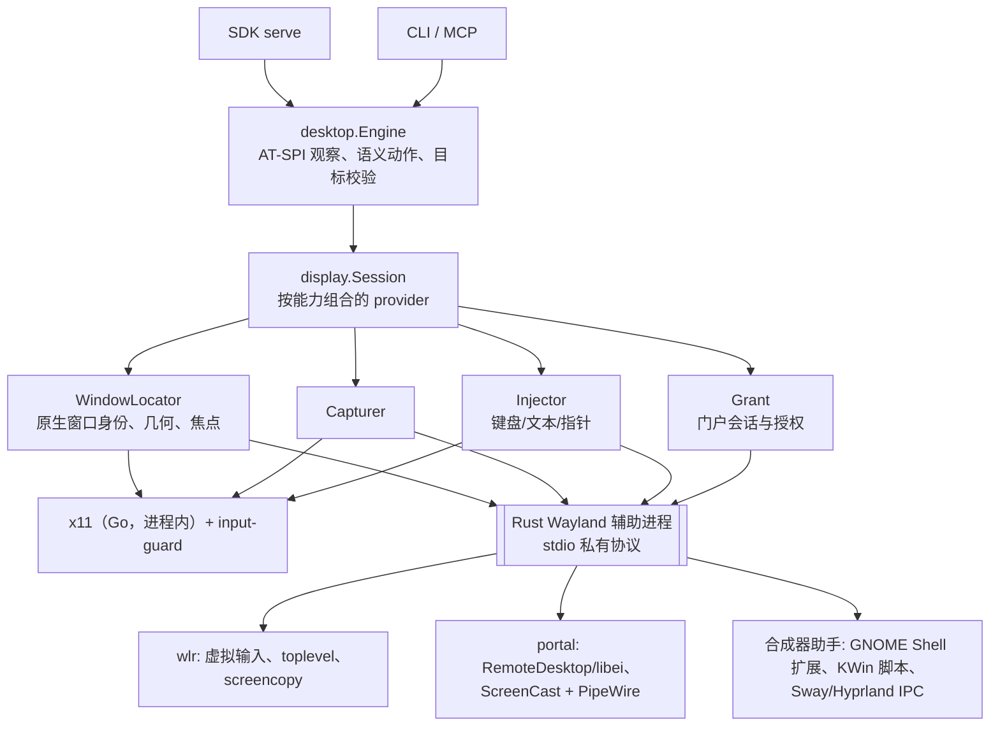

# Linux 显示后端架构：X11 与 Wayland

状态：2026-10-09 架构提案；W0 实验、W1 结构与 W3（GNOME/门户键盘）已于 2026-10-10 完成，Wayland 指针与截图尚未开放。X11 后端已作为[共用引擎](../exec-plans/active/20261009-linux-shared-engine.md)的一部分实现；本文定义如何在同一引擎内加入 Wayland 及其不同合成器，不改变 SDK 协议语义。语言分工（2026-10-09 决定）：Go 保持协议、会话、AT-SPI 与 X11；Wayland 平台细节由 Rust 辅助进程实现。决定自研，不嵌入第三方驱动；[trycua/cua](https://github.com/trycua/cua/tree/main/libs/cua-driver/rust/crates/platform-linux) 的 Linux 驱动只作参考。

## 目标与非目标

- 目标：AT-SPI 观察与语义动作在所有会话类型上共用一份实现；截图、窗口定位与全局输入按会话能力选择后端，并分别报告可用性。
- 目标：同一安全契约适用于所有后端：输入必须能绑定到观察到的目标窗口，做不到就在发送前拒绝，而不是送到别处后报告成功。
- 目标：Go 主程序保持无 cgo，X11 用户只需要它。Wayland 会话按需启动 Rust 辅助进程；需要额外系统库或安装步骤的能力是可选层，缺失时如实报告。
- 非目标：首批不支持所有合成器；不把 X11 注入（含对 XWayland 的 XTEST）当作 Wayland 支持；不绕过门户授权或合成器的安全策略。

## 为什么 Wayland 需要独立的结构

X11 中一个客户端即可查询任意窗口位置、读取像素、用 XTEST 注入输入，并通过输入焦点确认目标。Wayland 刻意不提供这些：

| 能力 | X11 | Wayland |
| --- | --- | --- |
| 窗口屏幕坐标 | `TranslateCoordinates` | 无全局坐标；GNOME 下 AT-SPI 窗口位置为 `0,0`，`org.gnome.Shell.Introspect` 不对普通客户端开放 |
| 焦点窗口 | `GetInputFocus` | 无标准查询；只能用 AT-SPI `ACTIVE` 状态或合成器私有接口 |
| 截图 | `GetImage` | 门户 ScreenCast + PipeWire、wlroots screencopy、或合成器内扩展 |
| 输入 | XTEST | 门户 RemoteDesktop（D-Bus `Notify*` 或 libei）、wlroots 虚拟设备协议 |
| 授权 | 无 | 门户会弹出系统授权；可持久化 |

而且不同合成器提供的协议不同：wlroots 系开放虚拟输入和 screencopy 协议，GNOME/KDE 主要通过门户，GNOME 的窗口几何只能从 Shell 内部获得。因此不能写一个 `wayland` 后端，而要按能力拼装。

## 分层



- **Engine（不变）**：AT-SPI 连接、树、语义动作、执行前重新校验。它不知道显示服务器类型，只向 `display.Session` 请求"这个 AT-SPI 窗口对应的原生窗口"和后续能力。
- **display.Session**：每个 runtime 一个，启动时探测会话，组合各 provider；持有所有原生连接、门户会话、guard 与临时状态，`Close` 时按 provider 逆序清理。
- **Provider**：每项能力一个 Go 接口，可由不同后端实现。x11 在进程内实现；Wayland 的实现是转发到 Rust 辅助进程的薄适配。一个会话可以混用后端，例如 GNOME 上用门户输入、Shell 扩展定位与截图；同一个 Wayland 会话里的 XWayland 窗口则走 x11 provider。

### 接口草图

```go
// Target 是引擎观察到的 AT-SPI 窗口；Locate 把它解析为原生窗口。
type Target struct{ PID uint32; Title string; Atspi desktop.Ref }

type NativeWindow struct {
    Kind     Kind            // X11, XWayland, Wayland
    ID       string          // 后端内稳定身份：XID、toplevel 句柄、合成器窗口 ID
    Bounds   *Rect           // 屏幕坐标；Wayland 下可能未知
    Focused  Tri             // Yes / No / Unknown
}

type WindowLocator interface {
    Locate(ctx, Target) (NativeWindow, error) // 无法唯一匹配时返回错误，不猜
}
type Capturer interface {
    Capture(ctx, NativeWindow) (Image, error)
}
type Injector interface {
    // 每次调用前都由实现重新验证焦点或落点；无法验证时返回 effect:none 的拒绝。
    Keys(ctx, NativeWindow, []KeyEvent) error
    Text(ctx, NativeWindow, string) error
    Pointer(ctx, NativeWindow, []PointerEvent) error // 坐标相对 NativeWindow
}
type Grant interface {
    Status(ctx) []Permission             // 映射到 SDK getPermissionStatus
    Request(ctx, []string) []Permission  // 映射到 SDK requestPermissions（门户授权）
}

type Availability struct{ Status, Code, Reason string } // 每个 provider、每个目标都可查询
```

Go 端接口不因语言分工改变。现有代码按此拆分：`capture.go` 的 `findX11Window`/`GetImage` 成为 x11 的 `WindowLocator`/`Capturer`；`input.go`、`guard.go`、`keys.go` 成为 x11 `Injector`；`engine.Wayland()`/`Display()` 被会话探测取代。第一步只做搬移，不改行为。

## 语言与进程边界

| 部分 | 语言 | 理由 |
| --- | --- | --- |
| SDK 协议、会话、取消、AT-SPI 引擎、x11、`input-guard` | Go（现有） | 已实现并在 Xvfb/真实桌面验证；与 Windows 共用 `runtime-go`；保持无 cgo 的交叉编译 |
| Wayland 协议、门户、libei、PipeWire、合成器 IPC | Rust 辅助进程 | Go 缺少成熟实现：Wayland 客户端只有小众纯 Go 库，libei 与 PipeWire 没有纯 Go 实现。Rust 有 `wayland-client`/`wayland-protocols`、`reis`（libei）、`ashpd`（门户）、`pipewire-rs` |
| GNOME Shell 扩展、KWin 脚本（若采用） | JavaScript | 只能在合成器内运行 |

不采用的方案：Go 主程序用 cgo（X11 用户也被迫依赖这些系统库，并破坏现有交叉编译）；C 辅助进程（可直接用官方库，但内存安全和协议、错误处理的代码量更大）。

### 辅助进程（暂名 `open-computer-use-wayland`）

- **何时启动**：`display.Session` 探测到 Wayland 会话且需要非 AT-SPI 能力时才按需启动，每个 runtime 一个，不跨任务共享；X11 会话从不启动。
- **协议**：stdio 上的版本化私有协议，沿用 runtime-go 的帧格式。握手时返回探测结果（会话类型、Wayland 全局对象、门户版本与设备类型、可用的合成器助手），作为 Go 端能力表的依据。请求携带目标描述（PID、观察到的标题、AT-SPI 引用）；原生句柄留在辅助进程内，不回传。
- **所有权与清理**：辅助进程持有门户会话、EIS 连接、Wayland 虚拟设备和 PipeWire 流。stdin EOF（runtime 正常关闭或被杀）时，它松开仍按住的输入、关闭会话后退出，与 `input-guard` 同一模式；Go 端在超时后强制结束它。辅助进程意外退出时，依赖它的能力报告不可用，进行中的动作按 `effect: possible` 处理，不自动重启后补发。
- **系统库**：除 PipeWire 外都是纯 Rust。libpipewire 缺失时就不加载：`pipewire-rs` 在构建时链接该库，链接它的程序在缺库的机器上无法启动，所以截图放进单独的可执行文件，只在需要截图时才启动；启动失败即报告截图不可用，输入与语义动作不受影响。W0 原型（不含截图）只依赖 libc/libm/libgcc，release 体积 5.4 MB（arm64）。
- **构建与分发**：`build-open-computer-use-linux.sh` 在 Go 运行时旁构建辅助进程，SDK 平台包把它放在 `runtime/` 下与 `open-computer-use` 同级，CLI 包与 Codex 插件也随运行时携带。GNOME 键盘路由要在运行时 `dlopen` libxkbcommon，静态 musl 程序做不到，因此发布构建（`--portable-helper`）用 cargo-zigbuild 按 glibc 2.28 链接（Debian 10、RHEL 8 及以后），不按构建机的 glibc（ubuntu-24.04 为 2.39）；脚本检查产物要求的最高 glibc 版本。SDK 分发工作流在安装验证中让辅助进程完成握手，并在 Debian 10 容器中启动它。依赖的许可证全文由 `scripts/wayland-helper-notices.mjs` 写入 `THIRD_PARTY_NOTICES.md`，CI 检查其是否过期。`Cargo.lock` 入库，纳入现有的依赖审查、OSV 扫描与 SBOM（见 [供应链安全](../SUPPLY_CHAIN_SECURITY.md)）。

## 后端矩阵（目标状态）

✅ 已实现 · 🧪 需实验确认 · ⛔ 不提供（如实报告）

| 会话 / 合成器 | 定位与焦点 | 截图 | 键盘/文本 | 指针 | 授权 |
| --- | --- | --- | --- | --- | --- |
| X11 | ✅ XID、`GetInputFocus` | ✅ `GetImage` | ✅ XTEST + guard | ✅ XTEST，校验落点 | 无 |
| Wayland 会话中的 XWayland 窗口 | 🧪 XID（XWayland 映射焦点） | 🧪 `GetImage` | 🧪 XTEST | 🧪 XTEST | 无 |
| wlroots（Sway、labwc、Hyprland 等） | ✅ Sway/Hyprland IPC 给出窗口的 PID、标题、几何与焦点；其他合成器回退到 AT-SPI ACTIVE | ✅ Sway 截取输出中的窗口区域（有浮动窗口重叠时拒绝）；✅ Hyprland `hyprland_toplevel_export` 按窗口 | ✅ `virtual-keyboard`，可输入任意 Unicode | ✅ `wlr-virtual-pointer`，移动后要求 IPC 焦点为目标 | 无 |
| GNOME（Mutter） | ✅ Shell 扩展：窗口的 PID、标题、几何、层叠与焦点（W4） | ✅ Shell 扩展按窗口绘制，被遮挡也可截取（W4） | ✅ 扩展内虚拟键盘，文本经输入法提交任意 Unicode（W4）；无扩展时门户 RemoteDesktop + libei | ✅ 扩展内虚拟指针，同一调用内确认落点窗口（W4） | 扩展由用户安装、重新登录，并在 Shell 内授权；无扩展时门户弹窗 |
| KDE（KWin，Plasma 6） | ✅ KWin 脚本：窗口的 PID、标题、几何、层叠、激活窗口、光标与 `windowAt`（W5） | ✅ `ScreenShot2.CaptureWindow`，被遮挡也可截取（W5） | ✅ `fake_input` 键码，按键前确认激活窗口（W5）；无集成时门户 + libei | ✅ `fake_input` 绝对坐标，移动后确认光标到位且 `windowAt` 最上层是目标（W5） | `install-kde-integration` 写入声明受限接口的 `.desktop`，无需重新登录；无集成时门户弹窗 |
| 其他（COSMIC 等） | 按探测到的协议拼装；都没有时 ⛔ | 同左 | 同左 | 同左 | — |

AT-SPI 语义动作在以上所有会话中都可用，不依赖此表。按发行版与协议展开的对照见下一节。

## 支持矩阵：发行版、桌面、合成器与协议

能做什么由会话类型（X11 或 Wayland）和合成器决定，发行版只决定默认桌面及其版本。下面先列各合成器实际提供的接口，再列每条路线的功能，最后把发行版归到路线上：大多数发行版归为一类，只单列有特殊情况的。

图例：✅ 已在 CI 或隔离会话中验证 · 🧪 已实现，未系统验证 · ☑️ 按版本与接口推断，未在该环境运行 · ⚠️ 部分可用 · ⛔ 不可用（如实报告）

### 合成器提供的接口

Wayland 全局对象由辅助进程在隔离会话中列出（2026-10-14）；门户一列为各桌面门户后端的已知能力，未逐一实测。

| 合成器 | 窗口列表 | 截图 | 输入注入 | 门户后端 |
| --- | --- | --- | --- | --- |
| Mutter（GNOME 50） | Wayland 上没有（实测 40 个全局对象中无窗口、截图、输入相关协议）；`org.gnome.Shell.Introspect` 不对普通客户端开放 → 只能用 Shell 扩展 | 同左；`org.gnome.Shell.Screenshot` 同样受限 | 同左 | ScreenCast、RemoteDesktop（`ConnectToEIS`） |
| KWin（Plasma 6.6） | 无标准协议；`org_kde_plasma_window_management` 受限；KWin 脚本（D-Bus `org.kde.kwin.Scripting`）对会话内进程开放 | D-Bus `org.kde.KWin.ScreenShot2`，受限，由 `.desktop` 授权；需要 OpenGL 合成与 screenshot 插件 | `org_kde_kwin_fake_input`（KDE 私有，受限，由 `.desktop` 授权） | ScreenCast、RemoteDesktop |
| Sway 1.11 | `ext_foreign_toplevel_list_v1`、`zwlr_foreign_toplevel_manager_v1`（无 PID、无几何）；Sway IPC 给出 PID、几何与焦点 | `zwlr_screencopy`、`ext_image_copy_capture`，只有整个输出的捕获源，没有按窗口的捕获源 | `zwp_virtual_keyboard_v1`、`zwlr_virtual_pointer_v1`，不受限 | ScreenCast；没有 RemoteDesktop |
| Hyprland 0.53 | Hyprland IPC 给出 PID、几何与焦点 | `hyprland_toplevel_export`，按窗口 | 同 Sway | ScreenCast；没有 RemoteDesktop |

我们需要而标准协议不提供的：窗口的 PID（用来对上 AT-SPI 的应用）、窗口的全局坐标（Wayland 刻意不暴露，AT-SPI 在 Wayland 下只给窗口内坐标）、某点最上层是哪个窗口（按下前确认目标）。按窗口截图的标准捕获源（`ext-foreign-toplevel-image-capture-source`）在以上三个合成器中都没有。门户是唯一跨 GNOME 与 KDE 的标准，但窗口由用户在对话框里选择、每个会话需要确认、输入是全局注入，只适合作后备。

### 各路线的功能

AT-SPI 语义动作（读取无障碍树、按元素执行动作、向聚焦的可编辑文本写入任意字符）在所有会话中都可用，前提是应用暴露 AT-SPI（GTK、Qt 默认暴露；Chromium/Electron 需要开启无障碍）。下表只比较依赖显示后端的能力；Wayland 下的翻页滚动以 Page Up/Page Down 按键发送，与按键同列。

| 路线 | 窗口定位 | 截图 | 被遮挡窗口截图 | 坐标点击、拖拽 | 按键、翻页滚动 | 布局外字符（如中文） | 一次性设置 | 验证 |
| --- | --- | --- | --- | --- | --- | --- | --- | --- |
| X11 会话 | ✅ XID、`GetInputFocus` | ✅ `GetImage` | ⚠️ 取决于窗口管理器是否合成 | ✅ XTEST，校验落点 | ✅ XTEST，确认焦点 | ✅ 临时改键位映射 | 无 | ✅ CI（Xvfb） |
| Wayland 中的 XWayland 窗口 | 🧪 XID | 🧪 `GetImage` | 🧪 | 🧪 XTEST | 🧪 XTEST | 🧪 | 无 | 🧪 |
| GNOME 46–50 + Shell 扩展 | ✅ PID、几何、层叠、焦点 | ✅ | ✅ | ✅ 同一调用内确认落点窗口 | ✅ 确认焦点 | ✅ 经输入法提交 | `install-gnome-extension`、重新登录、在 Shell 对话框中允许 | ✅ CI（GNOME 50、46）与真实桌面（GNOME 50.1） |
| GNOME 无扩展（含 45 及更早） | ⚠️ 只有 AT-SPI ACTIVE，无几何 | ⛔ | ⛔ | ⛔ | ✅ 门户 RemoteDesktop + libei，确认 ACTIVE；需要门户支持 `ConnectToEIS` | ⛔ 发送前拒绝 | 首次使用时系统对话框 | ✅ GNOME 50（W3） |
| KDE Plasma 6 + 集成 | ✅ PID、几何、层叠、激活窗口、`windowAt` | ✅ | ✅ | ✅ 确认光标到位且目标在最上层 | ✅ 确认激活窗口 | ⛔ 发送前拒绝 | `install-kde-integration`，无需重新登录 | ✅ 隔离 KWin 6.6.6 与 CI |
| KDE 无集成 | ⚠️ 只有 AT-SPI ACTIVE | ⛔ | ⛔ | ⛔ | ☑️ 门户 RemoteDesktop + libei | ⛔ | 首次使用时系统对话框 | ☑️ |
| KDE Plasma 5 | ⚠️ 只有 AT-SPI ACTIVE | ⛔ 集成需要 Plasma 6 的 KWin 脚本接口 | ⛔ | ⛔ | ☑️ 视门户是否支持 `ConnectToEIS` | ⛔ | — | ☑️ |
| Sway | ✅ IPC | ✅ 截取输出中的窗口区域 | ⛔ 与浮动窗口重叠时拒绝 | ✅ 移动后要求 IPC 焦点为目标 | ✅ 虚拟键盘，确认 IPC 焦点 | ✅ 自定义键位表 | 无 | ✅ CI |
| Hyprland | ✅ IPC | ✅ 按窗口导出 | ☑️ | ✅ 同 Sway | ✅ 同 Sway | ✅ | 无 | ✅ 本地（CI 无 GPU） |
| 其他 wlroots（labwc、Wayfire、river 等） | ⚠️ 只有 AT-SPI ACTIVE | ⛔ 没有 IPC 给出窗口几何 | ⛔ | ⛔ 无法确认焦点窗口 | ☑️ 有虚拟键盘协议时可用 | ☑️ | 无 | ☑️ |
| COSMIC 等其他合成器 | 按探测到的协议拼装，都没有时 ⛔ | 同左 | 同左 | 同左 | 同左 | 同左 | — | 未验证 |

### 发行版

除下表单列的情况外，发行版都按"默认桌面 + 版本"对照上表：Fedora Workstation 与 Fedora KDE、Arch 及其衍生版、openSUSE Tumbleweed、KDE neon 等跟进上游新版本的发行版，GNOME 在 46–50 之间、Plasma 为 6.x，走完整路线；它们只是没有在该发行版上运行过（☑️）。另一类是 Xfce、MATE、LXQt（X11）等仍运行在 X11 上的桌面，走 X11 路线。

| 发行版 | 默认桌面与会话 | 路线 | 说明 |
| --- | --- | --- | --- |
| Ubuntu 26.04 | GNOME 50，只有 Wayland 会话 | GNOME + 扩展 | ✅ CI 与真实桌面验证；没有 Xorg 会话可退回 |
| Kubuntu 26.04 | Plasma 6.6 | KDE + 集成 | ✅ CI 运行同版本的 KWin（`kwin-wayland` 加 `kwin-common`） |
| Ubuntu 24.04 | GNOME 46，Wayland（可选 Xorg 会话） | GNOME + 扩展 | ✅ CI；无头会话中 GTK 不报告 ACTIVE，真实桌面不受影响 |
| Kubuntu 24.04 | Plasma 5.27 | KDE Plasma 5 | ⛔ 集成需要 Plasma 6；建议登录 X11 会话 |
| Debian 13 | GNOME 48 / Plasma 6.3 | GNOME + 扩展 / KDE + 集成 | ☑️ Plasma 6.3 早于验证过的 6.6 |
| Ubuntu 22.04、Debian 12、RHEL 9 系（Rocky、Alma） | GNOME 42 / 43 / 40，默认 Wayland；Kubuntu 22.04 与 Debian 12 的 Plasma 为 5.x | GNOME 无扩展 / KDE Plasma 5 | ⛔ 扩展只支持 GNOME 46–50；☑️ 这些版本的门户不支持 `ConnectToEIS`，Wayland 下按键也不可用，只剩 AT-SPI 语义动作与 XWayland 应用。建议登录 Xorg 会话，走完整的 X11 路线 |
| RHEL 10 系 | GNOME 47，只有 Wayland 会话 | GNOME + 扩展 | ☑️ |
| Linux Mint（Cinnamon、MATE、Xfce） | X11 | X11 | ☑️ Cinnamon 的 Wayland 会话仍为实验性质，其合成器没有我们可用的接口 |
| Pop!_OS 24.04 | COSMIC | 其他合成器 | 未验证，按探测结果拼装 |
| Fedora Silverblue、Kinoite 等不可变发行版 | GNOME / Plasma 6 | 同可变版本 | ☑️ 扩展与 `.desktop` 都写在用户目录，不改动系统 |
| NixOS | 任意 | 按桌面 | 辅助进程位于 Nix store，每次升级路径都会变：KDE 需重新运行 `install-kde-integration`，GNOME 的 Shell 内授权也会重新询问 |
| glibc 早于 2.28 的发行版（Ubuntu 18.04、CentOS 7） | — | 只有 X11 | Wayland 辅助进程按 glibc 2.28 链接，无法启动；Go 运行时不依赖 glibc，X11 路线可用 |

## 探测与选择

会话启动时探测一次，结果可通过 `doctor` 输出，并决定 SDK 能力表：

1. **会话类型**：`XDG_SESSION_TYPE` 优先；未声明时看能否连上 `WAYLAND_DISPLAY`。`DISPLAY` 存在不代表 X11 会话（Wayland 下它指向 XWayland）。
2. **Wayland 全局对象**：连接后读取 `wl_registry` 广告的协议名和版本，例如 `zwlr_virtual_pointer_manager_v1`、`ext_image_copy_capture_manager_v1`、`ext_foreign_toplevel_list_v1`。按协议可用性选择，不按合成器名字猜。
3. **门户**：读取 RemoteDesktop 的 `version`（`ConnectToEIS` 和持久化需要 v2）与 `AvailableDeviceTypes`，ScreenCast 的 `AvailableSourceTypes`（窗口源为 2）。
4. **合成器助手**：`SWAYSOCK`、`HYPRLAND_INSTANCE_SIGNATURE`、`XDG_CURRENT_DESKTOP`，以及已安装助手的 D-Bus 名称。助手必须验证由本用户的合成器进程持有，才能作为可信来源。
5. **按目标选择**：同一会话里，XWayland 窗口和原生 Wayland 窗口走不同 provider；`Locate` 的结果决定后续用哪套实现。

## 坐标模型

SDK 坐标保持现状：相对观察到的窗口，越界在发送前拒绝。各后端负责换算：

- X11：`TranslateCoordinates`（已实现）。
- wlroots：窗口几何来自 Sway/Hyprland IPC；虚拟指针使用输出内绝对坐标。
- GNOME/KDE：门户的绝对指针坐标相对 ScreenCast 流，而门户只为**显示器流**提供 `position`，窗口流没有。因此指针要么需要可信的窗口几何（Shell 扩展、KWin 脚本），要么需要确认"窗口流内坐标即窗口坐标"这一合成器行为。两者都未验证前，这些会话的坐标点击、拖拽报告不可用，键盘与语义动作不受影响。
- AT-SPI 元素位置在 Wayland 下改用窗口坐标类型（`CoordType::Window`），再加上 provider 给出的窗口原点；拿不到原点时只提供窗口内坐标。

## 输入安全契约

所有 `Injector` 必须满足：

1. 发送前确认目标：键盘需要目标持有焦点，指针需要落点属于目标。确认手段由后端提供：X11 用输入焦点与 `QueryPointer`；wlroots 用 IPC 的 focused 与几何；GNOME/KDE 用 AT-SPI `ACTIVE` 加助手。若只能确认"某个窗口有焦点"却不能把输入绑定到目标，就拒绝：KWin 下 cua 也是同样的做法。
2. 焦点检查与送达之间存在竞争，任何后端都不承诺后台隔离；宿主仍需独占协调。
3. 已发送后的失败报告 `effect: possible`，不重试，不切换后端补发。
4. 按住的输入必须能在 owner 异常退出时释放：x11 已有 guard。libei 设备、门户会话和 wlroots 虚拟设备在客户端断开时是否自动松开，需要逐一实验；不能确认的，沿用 guard 模式（独立进程持有会话或在 EOF 时松开）。
5. `allowGlobalInput: false` 时任何后端都不发全局输入；CLI 门控保持不变。

## 授权与会话生命周期

- 门户授权映射到现有协议：Wayland 会话中 `getPermissionStatus` 报告 `remoteDesktop`（`granted`/`notDetermined`/`unavailable`），`requestPermissions` 发起门户会话并弹出系统对话框，用户拒绝返回 `denied` 而不是错误；X11 会话不报告任何权限。SDK 的动作调用本身不触发弹窗，未授权时返回 `PERMISSION_REQUIRED`；CLI 在第一次需要 Wayland 键盘时按需弹窗（CLI 每次进程都会重新询问）。GNOME 扩展（W4）的授权在 Shell 内完成，SDK 以单独的权限项报告其安装、重新登录与授权状态。
- 已知限制：辅助进程等待对话框时是阻塞的，SDK 取消 `requestPermissions` 只会让 Go 端返回，对话框仍然打开、辅助进程在用户回答前不处理其他请求。对话框没有父窗口，GNOME 不会把它提到前台。
- 持久化：门户 restore token 为一次性，需要每次会话后更新。token 的存放位置属于宿主（Cherry）的产品决定；runtime 只通过协议接收与返回，不自行在用户目录写入隐藏状态。
- 门户会话归 runtime 的 `display.Session` 所有，任务结束、EOF、`stop` 时关闭；不跨任务共享。

## 依赖与分发

| 组件 | 方式 | 影响 |
| --- | --- | --- |
| AT-SPI、X11 | Go（`godbus`、`xgb`），已实现 | 无 cgo |
| Wayland 客户端协议 | Rust `wayland-client` / `wayland-protocols` | 纯 Rust |
| 门户 | Rust `ashpd`（zbus） | 纯 Rust |
| libei | Rust `reis` | 纯 Rust；其 API 仍在变化，升级需预留成本 |
| PipeWire 取帧 | Rust `pipewire-rs`，需要系统 libpipewire | 运行时加载或拆成可选二进制 |
| GNOME Shell 扩展 | JavaScript，随包分发，由安装命令写入并启用，重新登录后生效 | 已决定提供（W4）；随 GNOME 大版本适配 |
| KWin 脚本 | JavaScript | 待定（W5） |

## 测试策略

| 后端 | 隔离环境 | CI |
| --- | --- | --- |
| x11 | Xvfb / Xephyr（已有 `x11-session.sh`） | ✅ 已接入 |
| 辅助进程协议与清理 | `cargo test` 加 Go 端假辅助进程测试（EOF、崩溃、超时） | 可接入 |
| wlroots | `testdata/wlroots-session.sh sway`：无头 Sway、软件渲染、私有 XDG 目录 | 可接入（无需 GPU） |
| Hyprland | `testdata/wlroots-session.sh hyprland`：Hyprland 0.53 无无头模式，嵌套在无头 labwc 中（需要 GPU render node 提供 dmabuf） | GitHub 运行器无 `/dev/dri`，预计无法接入 |
| GNOME | `testdata/gnome-session.sh`：无头 GNOME Shell、私有 XDG 目录，用 Mutter RemoteDesktop API 代替无人点击的门户对话框 | ✅ 已接入，独立的 `ubuntu-26.04` 任务（GNOME 50）；`ubuntu-24.04` 的 GNOME 46 在无头会话中聚焦了窗口，但 GTK 从不报告其为 ACTIVE，按键因此被拒绝 |
| KDE | 🧪 `kwin_wayland --virtual` | 待定 |

任何后端的全局输入测试都只在隔离会话中运行，不向开发者正在使用的桌面注入。

## 分阶段

| 阶段 | 内容 | 验收 |
| --- | --- | --- |
| W0 | 用 Rust 原型（`experiments/` 下）实验：GNOME 门户会话（只读，不发输入）与窗口流坐标；XWayland 下 XTEST/GetImage；libei 与门户会话断开时是否松键；无头 mutter/sway 能否跑门户。同时验证 Rust 在 CI 中构建 x64/arm64 与产物大小 | 结论写入本文与执行计划 |
| W1 ✅ | Go 端：`internal/display`（共享类型与 provider 接口）、`internal/display/x11`（搬入的截图、XTEST、guard）、`internal/display/wayland`（辅助进程客户端），引擎按会话组合并保持对外 API；Rust `wayland-helper/`：分帧、`hello` 握手与只读探测、EOF 退出；`doctor` 输出会话报告 | 现有行为不变、测试全部通过；辅助进程生命周期测试（Go 端假辅助进程 6 项、Rust 6 项）通过；打包见「构建与分发」 |
| W2 ✅ | wlroots 后端：虚拟键盘、窗口定位、按窗口截图、虚拟指针（Sway、Hyprland） | 无头 Sway 与嵌套 Hyprland 中引擎与 SDK 测试通过；Sway 接入 CI，Hyprland 需要 GPU 与带显示器的父合成器，只在本地运行 |
| W3 ✅（GNOME） | 门户 + libei 键盘/文本，授权映射到 `requestPermissions`；KDE 未验证 | 隔离 GNOME 会话中引擎与 SDK 测试通过：授权前拒绝、Ctrl+A 与按键、布局缺失字符发送前拒绝、目标窗口非活动时拒绝、辅助进程被杀后按键已释放 |
| W4 ✅ | GNOME Shell 扩展后端：窗口定位、按窗口截图、虚拟指针与键盘、输入法提交文本，Shell 内授权，`install-gnome-extension`（见「GNOME Shell 扩展」） | 隔离的无头 GNOME 中由运行时自己安装扩展后，引擎与 SDK 测试通过；CI 覆盖 GNOME 50 与 46 |
| W5 ✅ | KDE Plasma 6：KWin 脚本、`ScreenShot2`、`fake_input` 与 `.desktop` 授权，`install-kde-integration`（见「KDE Plasma」） | 隔离的 KWin 6.6.6 中由运行时自己安装授权后，引擎与 SDK 测试通过；CI 在 `ubuntu-26.04` 上运行 |

每个阶段独立成 PR；未完成的能力保持 unsupported/unavailable，并说明原因。

## W0 结论（2026-10-10，GNOME Shell 50.1，arm64）

原型位于 [experiments/LinuxWaylandProbe](../../experiments/LinuxWaylandProbe/README.md)，只读取信息，从未开始模拟输入。

- 门户版本：RemoteDesktop v2（`AvailableDeviceTypes` 键盘/指针/触摸），ScreenCast v5（显示器/窗口/虚拟源均可用）。
- **GNOME 接受 RemoteDesktop 搭配窗口源**。窗口流报告 `source=Window`、`size`、`mapping_id`，不报告 `position`。
- **libei 绝对指针以窗口为参照系**：通过 `ConnectToEIS` 绑定后，"standalone virtual absolute pointer" 设备只有一个区域 `0,0 2640x1766 scale=1`，其 `mapping_id` 与窗口流相同。因此在 GNOME 上可以用窗口内坐标寻址，不需要 Shell 扩展提供窗口原点。
- 窗口由用户在门户对话框中选择，runtime 无法指定，也无法从流信息确认选中的就是 AT-SPI 目标（只能用尺寸做弱校验）。目标绑定需要单独设计：例如每个应用会话请求一次授权并核对，或结合 restore token 复用同一窗口。
- 门户对话框没有父窗口时不会被提到前台（日志："Failed to associate portal window with parent window"），用户需要从概览中找到它。宿主发起授权时应提供父窗口标识。
- XWayland 窗口在真实 Wayland 会话中可用 X11 `GetImage` 正确截取（含 GNOME 50 由 `mutter-x11-frames` 绘制的标题栏）。同时发现：按标题查找会命中 `mutter-x11-frames` 这个注册了相同窗口标题的进程，应用解析需要排除它。
- W1 辅助进程在同一会话的探测：40 个 Wayland 全局对象，没有 wlroots 虚拟输入、foreign-toplevel、screencopy，也没有 `ext-image-copy-capture`。GNOME 50 只能走门户与（可选的）Shell 扩展。
- 尚未验证（需要发送输入，只能在隔离会话中做）：遮挡时窗口坐标输入是否仍送达该窗口；断开 EIS/门户会话时是否松开按住的键；XWayland 上 XTEST 的送达范围；无头 GNOME 能否运行门户。

## W3 结论（2026-10-10，GNOME Shell 50.1）

- 路径：门户 RemoteDesktop（仅键盘）→ `ConnectToEIS` → libei 键盘。GNOME 50 的 EIS（libei 1.5）不提供 `ei_text`，文本通过合成器下发的 XKB 键位表查找（`libxkbcommon` 运行时加载，缺失时键盘报告不可用）；只用前两级（无修饰/Shift），布局无法输入的字符（如中文）在发送前整体拒绝，Caps Lock 打开时拒绝输入字母。
- 目标绑定：libei 只送达合成器焦点。Go 端在每个键/字符之前通过 AT-SPI 确认目标窗口仍为 ACTIVE 且标题未变；检查与送达之间的竞争仍然存在，宿主需协调。
- 每次发送后用 `ei_connection.sync` 等待合成器确认，字符之间留 5 ms；合成器确认不代表客户端已读取。
- 清理：在隔离会话中让辅助进程按住 Shift 后被 SIGKILL，新会话输入的仍是小写，即 Mutter 在 EIS 客户端断开时释放其按键，GNOME 上不需要额外 guard。辅助进程正常退出时也会先释放并停止模拟。
- 测试环境：无头 GNOME 起初没有键盘，第一个 EIS 键盘出现后客户端才异步绑定键盘，这段时间内的按键会丢失；`testdata/gnome-session.sh` 在会话开始时保持一个键盘，模拟有物理键盘的桌面。
- 测试隔离事故：最初的会话脚本与真实桌面共用 `XDG_RUNTIME_DIR` 和配置目录，退出时删除了真实会话的 AT-SPI 总线 socket，并写入了真实的 GNOME Shell 状态文件。脚本现为每个会话创建私有的运行时、配置、数据、缓存与状态目录，并验证真实目录前后不变。
- CLI：X11 与 XWayland 窗口仍走 XTEST；原生 Wayland 窗口走门户键盘。SDK：Wayland 下 `pressKey`、`scroll`（翻页键）与无焦点文本框时的 `typeText` 需要 `allowGlobalInput` 与 `remoteDesktop` 权限；指针仍为 unsupported。
- 未覆盖：真实 GNOME 桌面上的门户对话框流程（W0 已人工确认对话框可用，但键盘输入只在隔离会话中验证）、KDE、门户授权持久化。CI 在无头 GNOME 中运行引擎与 SDK 键盘测试。

## W2 键盘结论（2026-10-12，Sway 1.11 / Hyprland 0.53.3）

- 路由：合成器提供 `zwp_virtual_keyboard_manager_v1` 时，Wayland 按键走辅助进程的虚拟键盘，不弹对话框、不需要 `remoteDesktop` 权限（SDK 的权限列表为空）；否则走门户 + libei。SDK 仍要求 `allowGlobalInput`。
- 目标绑定：每个键/字符之前，Sway（`GET_TREE`）或 Hyprland（`j/activewindow`）IPC 报告的焦点窗口必须是目标的 PID 与观察到的标题；没有已知 IPC 的合成器回退到 AT-SPI ACTIVE。比 GNOME 上只能依赖 AT-SPI 更强，但检查与送达之间仍有竞争。
- 键位表：辅助进程自己生成 XKB 键位表，键符以数字写出，因此任意 Unicode（包括中文）都能输入，不需要 libxkbcommon。修饰键、可打印 ASCII、命名键与 F1–F24 在每个设备上占用固定键码，其他字符追加在后面且键码不复用：客户端可能用旧的（甚至上一个设备的）键位表解析快捷键，键码改变含义时 Ctrl+A 会被解析成别的键。
- 修饰键：wlroots 不从虚拟键盘的按键推导修饰状态，需要先按下修饰键使设备成为座位当前键盘，再通过 `modifiers` 请求上报，最后反向撤销。
- 清理：持有 Control 与一个键时 SIGKILL 辅助进程，Sway 与 Hyprland 都会在设备销毁时释放；Hyprland 会把修饰状态留在座位上直到某个键盘重新上报，因此辅助进程在创建设备与输入文本前先清零修饰状态。
- 测试发现：此前 GNOME 与 X11 的引擎测试在已全选的输入框上按 Ctrl+A，无法证明修饰键生效；现在先设置文本、按 End 再按 Ctrl+A。SDK 桌面测试一直在无选区的文本上验证。
- 隔离会话：`wlroots-session.sh` 与 GNOME 一样在会话开始时保持一个键盘；Hyprland 的 IPC socket 位于运行时目录深处，私有根目录必须足够短（Unix socket 路径上限 108 字节）。

## W2 截图与指针结论（2026-10-12，Sway 1.11 / Hyprland 0.53.3）

- 窗口定位：辅助进程通过 Sway（`GET_TREE`）或 Hyprland（`j/clients`）IPC 按 PID 与观察到的标题查找唯一窗口，多个匹配时拒绝。坐标是合成器布局中的逻辑坐标。Sway 的 `rect` 是标题栏以下的容器，客户端内容还要加上 `window_rect` 偏移（去掉边框）；判断浮动窗口遮挡时则要算上它的边框与标题栏。Wayland 下计算元素坐标前，要求 AT-SPI 窗口尺寸与合成器报告的内容尺寸相差不超过 2 像素，否则拒绝（尚未完成的重排、客户端自绘阴影都会使坐标整体偏移）。
- 截图：Sway 用 `zwlr_screencopy` 截取窗口所在输出的对应区域，有浮动窗口与之重叠时拒绝（区域截图会包含遮挡内容）；Hyprland 用 toplevel export 按窗口导出。Go 端把共享内存帧转为 PNG，并缩放到窗口逻辑尺寸，使截图坐标与指针坐标一致。其他合成器报告 unsupported。
- 指针：`zwlr_virtual_pointer` 以绝对坐标移动，范围是 `xdg_output` 报告的所有输出逻辑矩形的外包框（wlroots 对未绑定输出的绝对设备即如此映射），每个手势重新读取输出布局。Go 端先确认目标可见且包含该点，移动指针，再要求 IPC 报告的焦点窗口是目标（焦点跟随鼠标，Sway 与 Hyprland 的默认设置），并再次确认目标仍包含该点，然后才按键；否则以 effect `none` 拒绝。面板、通知等不获取焦点的表面无法这样识别。拖拽在按下后分 10 步移动。
- 元素点击：Wayland 下 AT-SPI 不知道窗口位置，元素中心取窗口坐标系的 extents 加上合成器报告的窗口原点。
- 设备生命周期：无头合成器没有物理指针，每次新建、销毁虚拟指针会让座位的指针能力反复出现，客户端异步绑定 `wl_pointer` 期间的点击会丢失（测试中偶发）。虚拟指针因此在辅助进程生命周期内常驻，首次创建后等待 200 ms；`wlroots-session.sh` 也在会话开始时保持一个指针。
- Hyprland：嵌套在无头父合成器（labwc、无头 GNOME）中时没有显示器，窗口只有 5x5；`OCU_HYPRLAND_PARENT=wayland-0` 让它嵌套到真实显示中（出现一个窗口，输入只进入嵌套 Hyprland 自己的座位），在 virgl 加速的虚拟机中获得 1024x768 显示器，键盘、截图、指针测试与 SDK 测试通过。toplevel export 只含窗口内容（GTK 3 的客户端阴影不在其中，AT-SPI 窗口尺寸与 IPC 一致），被浮动窗口遮挡时仍能截图；遮挡时点击同样因焦点落到遮挡窗口而被拒绝。

## GNOME Shell 扩展（W4，2026-10-13 方案与验证）

### 为什么是扩展

GNOME 不向普通客户端提供 wlroots 协议、`ext-image-copy-capture` 或窗口归属信息，门户只能给出用户选择的画面。比较过的做法：

- **门户 ScreenCast 窗口源**：用户在对话框中选中的窗口无法证明就是 AT-SPI 观察到的目标（moeru-ai/auv 也因此放弃了这条路）。
- **门户显示器源 + 按窗口位置裁剪**（moeru-ai/auv 的做法）：窗口位置取自 gnome-shell 自己的 AT-SPI「Main stage」树。在真实 GNOME 50 桌面上只读实验：树中「Wayland window」节点的顺序就是自下而上的层叠顺序，ACTIVE 窗口总在最后（4/4），GTK 3 窗口的 AT-SPI 窗口尺寸与节点尺寸一致，节点给出真实屏幕位置。但节点没有 PID 与标题，只能按尺寸匹配；同尺寸的最大化窗口无法区分，通知横幅不在其中，被遮挡时裁剪会截到遮挡物，只能截取激活窗口。它还需要门户授权与 PipeWire。扩展可用后，这种无扩展退路的价值不抵其成本，因此不实现。
- **`org.gnome.Shell.Introspect.GetWindows`**：GNOME 50 对白名单外的调用返回 `AccessDenied`，旧的 `introspect` 设置项已移除。
- **Shell 扩展**（trycua/cua 的 WinRects 已用于定位、截图与激活）：扩展运行在 gnome-shell 内，能读取每个窗口的身份与层叠，并在同一次调用中确认落点后送达输入。代价是安装后需要重新登录、随 GNOME 版本适配、扩展出错会使整个会话崩溃，以及重新开放了 GNOME 有意收紧的截图与窗口列表能力，因此必须由用户授权。

### 可行性验证（隔离的无头 GNOME 50，unsafe mode 下用 `Shell.Eval` 运行与扩展相同的 JavaScript）

| 能力 | 做法 | 结果 |
| --- | --- | --- |
| 窗口列表 | `global.get_window_actors()`、`sort_windows_by_stacking`、`get_pid`、`get_title`、`get_frame_rect`/`get_buffer_rect`、`focus_window` | ✅ PID 与夹具进程一致，层叠自下而上，焦点正确 |
| 被完全遮挡的窗口截图 | `MetaWindowActor.paint_to_content` 取窗口纹理，按 frame 相对 buffer 的偏移与 `get_resource_scale` 裁剪，`Shell.Screenshot.composite_to_stream` 编码 PNG；先挂一个透明的 1x1 `Clutter.Clone`，避免 Mutter 停止绘制被完全遮挡的窗口（cua 的做法） | ✅ 被另一窗口完全覆盖时得到 400x363 的目标窗口画面，不含遮挡物 |
| 落点窗口 | `global.stage.get_actor_at_pos(Clutter.PickMode.REACTIVE, x, y)` 向上找到 `meta_window`；Shell 自己的界面（通知、菜单）也是 stage 上的角色 | ✅ 覆盖时返回遮挡窗口，置顶后返回目标 |
| 虚拟指针 | 默认 seat 的 `create_virtual_device(POINTER_DEVICE)`，`notify_absolute_motion` 后在同一调用内检查落点窗口，是目标才 `notify_button` | ✅ 被覆盖时拒绝、计数不变；置顶后点击，计数 0 → 1 |
| 虚拟键盘 | `create_virtual_device(KEYBOARD_DEVICE)`，`notify_keyval`/`notify_key` | ✅ 送达焦点控件；布局中没有的键符被 Mutter 丢弃（`No keycode found for keyval`） |
| 任意文本 | `Main.inputMethod.commit(text)`（GNOME 屏幕键盘提交 emoji 的方式），经 text-input-v3 交给焦点客户端 | ✅ `中文 😀 é` 原样进入 GTK 输入框 |

注意：键盘只送达窗口内的焦点控件。验证中先点击了按钮，按键随后进入按钮而不是输入框；扩展只保证目标窗口有焦点，控件焦点仍由引擎经 AT-SPI 确认。

### 设计

- **扩展** `computer-use@cherryai`（GNOME 46–50，ESM），在会话总线上导出 `com.cherryai.ComputerUse.Shell1`：窗口列表；按窗口截图（PNG 以 D-Bus 字节数组 `ay` 返回，不用 base64）；激活并返回焦点是否到达；落点窗口查询；点击、拖拽、滚动（每次在同一调用中确认落点窗口是目标）；按键与文本（确认焦点窗口是目标；文本优先经输入法提交，客户端不支持 text-input 时退回布局内键符，布局外拒绝）。每个请求携带目标的 PID 与标题，扩展按 `get_stable_sequence` 找到窗口后再核对两者。锁屏与登录界面时拒绝一切请求。
- **授权**：授权绑定到调用方的可执行文件（由总线取得调用方 PID，读取内核给出的 `/proc/<pid>/exe`，即辅助进程本身）。SDK 的 `requestPermissions({ ids: ['gnomeShell'] })` 或 CLI 第一次需要时调用 `Authorize`，Shell 弹出模态对话框（默认按钮为拒绝），并显示请求方的路径；授权持续到锁屏（GNOME 在锁屏时禁用扩展）或注销，顶栏显示控制中的提示并可随时撤销。SDK 的 `gnomeShell` 权限在扩展运行前为 `unavailable`（`systemSettings`：需要安装并重新登录），之后为 `notDetermined`、`granted` 或 `denied`。扩展默认不做任何事，安装本身不等于授权。
- **辅助进程与引擎**：辅助进程在会话总线上发现扩展后，GNOME 的定位、截图、指针与键盘都走扩展；门户 + libei 键盘保留给未启用扩展的 GNOME 与 KDE。
- **安装**：扩展文件嵌入运行时二进制。`open-computer-use install-gnome-extension` 把它写入 `$XDG_DATA_HOME/gnome-shell/extensions/` 并启用：Shell 已认识该扩展时用 `gnome-extensions enable`，否则把它加入 `enabled-extensions` 设置，然后提示重新登录（Wayland 下新装的扩展只在重新登录后加载）。用户扩展被关闭（`disable-user-extensions`）时只报告，不替用户或管理员修改。`uninstall-gnome-extension` 撤销上述改动。SDK 从不自动安装。
- **稳定性**：扩展只做上述操作，每个入口捕获异常并以 D-Bus 错误返回，避免拖垮 gnome-shell；虚拟设备与透明克隆在禁用或空闲后释放。
- **测试**：无头 GNOME 会话可在启动前把扩展放进私有数据目录并启用，CI 中加载真实扩展（`ubuntu-26.04` 为 GNOME 50，`ubuntu-24.04` 为 GNOME 46）。

### W4 实现结果（2026-10-13）

- 辅助进程（`shell.rs`）通过会话总线调用扩展：`window.find`/`window.capture` 在 GNOME 上改由扩展列出与截取窗口，`shell.*` 方法负责授权、点击、拖拽、组合键与文本。扩展的 D-Bus 错误名映射为运行时错误码；`Possible` 表示输入已发送、效果未知。zbus 的超时按连接设置，等待用户回答对话框的调用使用单独的长超时连接，两者都来自辅助进程本身。
- 引擎：扩展存在时，GNOME 的截图（按窗口逻辑尺寸缩放）、窗口定位、点击、拖拽、按键与文本都走扩展；键盘选择顺序为扩展、wlroots 虚拟键盘、门户。元素坐标以 client 表面（含客户端阴影，即 `get_buffer_rect`）为原点，并要求 AT-SPI 窗口尺寸与其一致。缺少授权时 SDK 返回 `PERMISSION_REQUIRED`，CLI 弹出 Shell 对话框一次后重试。
- 测试：`gnome-session.sh` 可在 Shell 启动前运行运行时自己的 `install-gnome-extension`，与用户首次安装的路径相同；对话框通过只在 unsafe mode 下可用的 `Shell.Eval` 回答。`TestGNOMEShellExtension` 覆盖授权前拒绝、拒绝与允许、被遮挡窗口截图、遮挡时拒绝点击、单击、双击、拖拽、Ctrl+A、Unicode 文本、焦点在别处时拒绝、撤销后拒绝；SDK 桌面测试覆盖 `gnomeShell` 的授权流程，以及无扩展时的 `unavailable`。
- 指针到位确认：GNOME 50 CI 上扩展放行了双击，计数却不变；Shell 状态显示光标停在 (512, 0)，新虚拟指针的移动被丢弃，按下落在了光标原来的位置。扩展因此在移动后读取光标位置，最长 1 秒内重发移动，新设备先原地移动一次；光标未到位则拒绝并说明它停在哪里。命中检查只看坐标处的窗口，不能代替这一步。
- 真实桌面（GNOME 50.1，Parallels 虚拟机，2026-10-13）：`install-gnome-extension` 后用户需打开用户扩展总开关（本机原为关闭，安装命令只提示）并重新登录；扩展 `ACTIVE`，`doctor` 报告截图与全局输入可用；对话框授权后截图、双击、坐标点击、Ctrl+A 与退格均生效；从顶栏停止后重新授权，新建的虚拟指针在鼠标静止时首次点击即成功。点击“允许”后立即移动鼠标时，宿主同步的绝对位置会覆盖虚拟指针，点击按设计被拒绝并提示鼠标可能正在使用。
- 未覆盖：GNOME 45 及更早版本；Electron、Qt 等客户端是否支持 text-input（不支持时只发送 ASCII，其余字符在发送前拒绝）。

## KDE Plasma（W5，2026-10-14 方案与验证）

### 为什么这样做

KWin 有三种官方能力可用，不需要像 GNOME 那样在合成器进程里运行代码：

- **KWin 脚本**（JavaScript，经 `org.kde.kwin.Scripting` 加载，不需编译，跟随 Plasma 6 稳定的脚本 API）：读取 `workspace.stackingOrder` 中每个窗口的 `pid`、`caption`、`internalId`、`frameGeometry`/`bufferGeometry`、`active`、`minimized` 与类型（`dock`、`notification` 等），以及 `workspace.activeWindow`、`cursorPos`、`windowAt(pos)`。脚本只能用 `callDBus` 向外调用，不能导出方法。
- **`org.kde.KWin.ScreenShot2.CaptureWindow`**：按 `internalId` 截取一个窗口。受限接口：KWin 读取调用方的 `/proc/<pid>/exe`，在应用目录中找 `Exec=` 第一项（规范化后）与之相同的 `.desktop`，其 `X-KDE-DBUS-Restricted-Interfaces` 须列出该接口。
- **`org_kde_kwin_fake_input`**（KDE Connect 使用的 Wayland 协议）：绝对坐标指针、按键与键码。同一机制下由 `X-KDE-Wayland-Interfaces` 授权，未授权的客户端在注册表中看不到这个全局对象。

比较过的做法：trycua/cua 的 KWin effect 插件（C++，与 KWin/Qt ABI 绑定，只读，KDE 上拒绝原始输入）；isac322/kwin-mcp（ScreenShot2、KWin 脚本、KWin 私有 EIS 接口，输入不绑定目标）。在 KWin 进程内同一调用中确认并注入（与 GNOME 扩展同级）只能靠 effect 插件，代价是每次升级 Plasma 都要重新编译、加载失败影响桌面，因此不采用。

### 可行性验证（隔离的 KWin 6.6.6，`testdata/kwin-session.sh`）

| 能力 | 结果 |
| --- | --- |
| KWin 脚本的窗口列表、激活窗口、光标 | ✅ PID 与夹具进程一致；层叠、几何、激活状态正确；加载、运行、回传、卸载一次约 25 ms |
| `ScreenShot2.CaptureWindow` | ✅ 未授权时 `NoAuthorized`；`.desktop` 授权后截到被完全覆盖的目标窗口自身的内容（不含 KWin 标题栏与阴影） |
| `fake_input` 授权 | ✅ 无声明时注册表中没有该全局对象；写入 `.desktop` 并运行 `kbuildsycoca6` 后约 0.5 秒可用，不需重新登录 |
| 移动后的光标与落点 | ✅ `fake_input` 绝对移动后脚本立即读到新的 `cursorPos`；覆盖时 `windowAt` 返回遮挡窗口，置顶后返回目标 |
| 点击、双击 | ✅ 移动与按下之间间隔约 40 ms 时全部生效；紧接移动按下（另一连接）时有丢失 |
| 按键 | ✅ 键码（End、退格、h、i）把 "beta" 改成 "hi" |
| Plasma 面板与通知（`OCU_KWIN_PLASMASHELL=1`，需先启动 `kactivitymanagerd`） | ✅ 面板是 `dock` 窗口、通知弹窗是 `notification` 窗口，都在 `stackingOrder` 中；被面板或通知覆盖的点，`windowAt` 返回它们而不是目标 |
| 多显示器（两个输出并排） | ✅ 全局逻辑坐标：第二个输出上的目标，光标、`windowAt` 与点击都正确 |
| 1.5 倍缩放（`kscreen-doctor` 设置输出缩放） | ✅ 几何、`cursorPos`、`fake_input` 与 AT-SPI 窗口坐标都是逻辑坐标，点击正确；截图为物理像素 600x498，元数据 `scale: 1.5`，需缩放到逻辑尺寸 |
| 授权生效时间 | ⚠️ 写入 `.desktop` 并运行 `kbuildsycoca6` 后，`fake_input` 约 0.5 秒可用，`ScreenShot2` 有一次约 10 秒才生效；安装命令须等待并确认授权已生效 |

元素坐标：GTK 3 在 KWin 下使用服务端标题栏，AT-SPI 窗口坐标以 `bufferGeometry`（客户区）为原点。

### 设计

- **查询**：辅助进程在会话总线上注册接收对象，每次查询写入一段带随机令牌的脚本（私有运行时目录，0600），`loadScript` → `run` → 等待回传 → `unloadScript`。KWin 的脚本接口对任何进程开放，所以只接受由 `org.kde.KWin` 的当前所有者发出且令牌匹配的回传。
- **截图**：`CaptureWindow(internalId, {include-decoration: false, include-shadow: false}, pipe)`，读取原始图像与元数据（QImage 格式、尺寸、行宽、缩放），转为 PNG 并缩放到窗口逻辑尺寸。
- **输入**：辅助进程保持一个 `fake_input` 连接。点击：查询确认目标可见 → 绝对移动 → 约 40 ms → 查询确认光标已到、`windowAt` 最上层是目标（面板、通知也是 KWin 窗口，能被识别）→ 按下。按键：每个键之前确认激活窗口是目标的 PID 与标题。键码按当前布局（辅助进程已有的 xkbcommon 键位表）查找，布局缺失的字符在发送前拒绝；有焦点文本框时文本仍走 AT-SPI。检查与送达之间存在毫秒级竞争，与 Sway 同级。
- **安装与授权**：`open-computer-use install-kde-integration` 写入 `~/.local/share/applications/` 下的 `.desktop`（`Exec=` 为辅助进程绝对路径，`NoDisplay=true`，声明上述两个受限接口）并运行 `kbuildsycoca6`，然后让辅助进程确认两个接口都已可用（最多等待约 15 秒）再报告成功；`uninstall-kde-integration` 撤销。KDE 没有运行时授权对话框，安装即授权。SDK 增加 `kdeIntegration` 权限：未安装或辅助进程路径已变（例如 npm 升级）时为 `unavailable`（`systemSettings`，提示重新运行安装），否则为 `granted`；辅助进程以 `fake_input` 是否可见判断。
- **无集成时**：键盘沿用门户 + libei；截图与指针报告不可用并提示安装。
- **范围与 CI**：仅 Plasma 6（ubuntu-24.04 为 Plasma 5.27，不纳入）。CI 在 ubuntu-26.04 上用 `kwin-session.sh` 运行引擎与 SDK 测试。

### W5 实现结果（2026-10-14）

- 辅助进程 `kwin.rs`：每次查询加载一段带令牌的脚本，回传由会话总线上的接收对象处理，只接受 KWin 当前所有者发出且令牌匹配的回传，一次约 25 ms。zbus 在本构建中运行于 tokio（ashpd 为整个构建开启了该特性），注册接收对象会派生任务，因此接收端有一个单工作线程的运行时。截图经管道读取 ScreenShot2 的原始图像；`fake_input` 连接在辅助进程生命周期内保持。窗口的内容区是 frame 与 buffer 的交集（服务端标题栏下的客户区，或客户端阴影内的 frame），元素坐标以 buffer 为原点。
- Go：GNOME 扩展与 KWin 合并为“合成器协助”的输入路线（`wayland.Route`，方法前缀 `shell.*`/`kwin.*`），引擎按路线发送点击、拖拽、组合键与文本；SDK 增加 `kdeIntegration`。
- `install-kde-integration` 写入指向辅助进程规范路径的 `.desktop`，运行 `kbuildsycoca6`，在 KDE 会话中启动辅助进程确认两个接口都已可用（最多约 15 秒）后才报告成功；`uninstall-kde-integration` 撤销。
- 测试：`kwin-session.sh` 在 KWin 启动后运行运行时自己的安装命令。`TestKDEIntegration` 覆盖授权状态、截图（含被覆盖时）、覆盖时拒绝点击（说明遮挡窗口）、单击、双击、拖拽、Ctrl+A、布局文本、布局外字符在发送前拒绝、目标非激活时拒绝按键；SDK 桌面测试覆盖安装后的 `kdeIntegration: granted`，未安装时截图与指针报告需要安装。
- 隔离会话踩到的问题：KWin 跟随所在 logind 会话的锁定状态，桌面锁屏时隔离的 KWin 一启动就显示全屏的锁屏后备窗口，挡住所有窗口、脚本也无法移动它们；`kwin-session.sh` 以 `--no-lockscreen` 启动。
- CI 踩到的问题：KDE 的应用缓存（KSycoca）只收录应用菜单包含的 `.desktop`，`kbuildsycoca6` 找不到 `${XDG_MENU_PREFIX}applications.menu` 时缓存里没有任何应用，KWin 就找不到授权。真实 Plasma 由 plasma-workspace 提供 `plasma-applications.menu`，startplasma 设置 `XDG_MENU_PREFIX=plasma-`；只装了 KWin 的 CI 没有菜单。`kwin-session.sh` 照 startplasma 设置前缀，没有 Plasma 菜单时在私有配置目录写一个包含全部应用的菜单；安装命令超时时会指出菜单缺失。同一次排查还发现，用不存在的窗口探测 ScreenShot2 时把除 NoAuthorized 外的任何错误（如超时）都当成已授权；现在只有 KWin 在权限检查之后给出的 InvalidWindow 才算。修正后暴露出 CI 的第二个缺口：ScreenShot2 由 KWin 的 screenshot 插件提供，它在 Debian/Ubuntu 的 kwin-common 包里，而 Ubuntu 26.04 的 kwin-wayland 不依赖 kwin-common（完整的 Plasma 会装上），CI 现在显式安装它；辅助进程在 ScreenShot2 对象不存在时报告插件缺失，安装命令把 ScreenShot2 的错误原样带出。再往下一步：KWin 只在 OpenGL 合成时能截取窗口，QPainter 合成时 CaptureWindow 一律返回 Cancelled；CI 退回 QPainter 有两个原因：缺少 Mesa 的软件渲染驱动，以及虚拟后端只在找到 DRM 设备时才启用 OpenGL 而 runner 没有 `/dev/dri`。现在安装 mesa-libgallium，并像 KWin 自己的 CI 一样加载 vgem 内核模块（设置了 `CI` 环境变量时 KWin 直接打开 `/dev/dri/card1`，因为新内核把 vgem 放在 libdrm 尚不枚举的 faux 总线上；runner 上 `card1` 是没有渲染能力的 Hyper-V 显示设备，CI 把 vgem 的设备节点挂载到它上面）；辅助进程在 QPainter 下把 Cancelled 报告为需要 OpenGL 合成。真实 Plasma 即使没有 GPU 也用 llvmpipe 走 OpenGL。
- 未覆盖：真实 Plasma 桌面上的安装与使用；Plasma 6.0–6.5（只在 6.6.6 上验证）；KWin 对 `.desktop` 授权的缓存刷新时间在不同机器上的差异。

## W2 前置探测（2026-10-12，Sway 1.11 / Hyprland 0.53.3，均在隔离会话中只读探测）

- Sway：虚拟键盘/指针、`zwp_input_method_manager_v2`（可提交任意 Unicode，包括中文）、`ext-foreign-toplevel-list` 与 `wlr-foreign-toplevel`、`swaymsg` IPC。截图只有输出级的 screencopy 与 `ext-image-copy-capture`（无按窗口来源），按窗口截图只能裁剪输出，会包含遮挡内容。
- Hyprland：同样的输入与窗口列表协议，另有 `hyprland_toplevel_export_manager_v1`（按窗口导出，不受遮挡影响）与 `hyprctl` IPC；没有 `ext-image-copy-capture`。
- Hyprland 0.53 只能使用 DRM 或嵌套 Wayland 后端；嵌套要求父合成器提供 `xdg_wm_base` v6 与 dmabuf：Sway 1.11 只有 v5，labwc 与 GNOME 满足。`Hyprland` 会脱离启动它的进程，清理必须按会话标记查找进程，而不能只按 PID。
- 隔离事故：早期临时探测脚本在 `dbus-run-session` 内部才设置私有 XDG 目录，私有总线激活的服务仍使用真实运行时与配置目录（辅助功能 socket 未受损，个别状态文件是否被写入无法区分）；失败的无头 Hyprland 尝试还留下了 `/var/crash` 崩溃报告与未退出的进程。`wlroots-session.sh` 在启动总线前设置私有目录、只加载自己的合成器配置（Sway 的系统配置会把会话环境导入用户 systemd），并验证真实目录、systemd 用户环境与 `/var/crash` 前后不变。

## 待确认问题

1. ~~GNOME 是否允许 RemoteDesktop 搭配窗口源~~：允许（见 W0 结论）。仍需确认：窗口被遮挡时输入是否送达该窗口；如何把用户选择的窗口绑定到 AT-SPI 目标。
2. ~~libei 区域能否与门户流对应~~：能，区域 `mapping_id` 与窗口流一致，参照系为窗口。KDE 尚未验证。
3. 客户端断开时是否释放按住的键：Mutter 会释放（W3 已验证）；KWin 与 wlroots 虚拟键盘待验证。
4. XWayland：`GetImage` 已确认可用；XTEST 的送达范围待在隔离会话中验证。
5. ~~是否提供 GNOME Shell 扩展~~：提供，含输入（见「GNOME Shell 扩展」）。~~KWin 脚本~~：采用 KWin 脚本加 `ScreenShot2` 与 `fake_input`（见「KDE Plasma」）。
6. ~~libpipewire 缺失时的处理~~：不加载，截图放在单独的可执行文件中（见"辅助进程"）。GNOME 改由扩展截图后，PipeWire 只与 KDE 有关。
7. 门户 restore token 由宿主存放的协议形式。
8. Rust 工具链如何进入 CI 与发行流程：交叉编译方式、二进制大小、许可证审查。

## 参考

- [XDG RemoteDesktop portal](https://flatpak.github.io/xdg-desktop-portal/docs/doc-org.freedesktop.portal.RemoteDesktop.html)：`ConnectToEIS` 与持久化自 v2；绝对指针依赖 ScreenCast 流。
- [XDG ScreenCast portal](https://flatpak.github.io/xdg-desktop-portal/docs/doc-org.freedesktop.portal.ScreenCast.html)：窗口源类型 2；`position` 仅用于显示器流；restore token 一次性。
- [ext-image-copy-capture 合入 wayland-protocols](https://phoronix.com/news/Wayland-Merges-Screen-Capture)：wlroots 0.19 / Sway 1.11 起支持；GNOME 50 未向普通客户端提供（W1 探测），KWin 待确认。
- [trycua/cua platform-linux](https://github.com/trycua/cua/tree/main/libs/cua-driver/rust/crates/platform-linux)：按合成器分层、libei、GNOME Shell 扩展与 KWin 下拒绝目标输入的做法；同样选用 `reis`、`ashpd` 与 `pipewire-rs`。
- [trycua/cua WinRects 扩展](https://github.com/trycua/cua/tree/main/libs/cua-driver/wayland-helper)：GNOME 45–50 的窗口几何、按窗口截图（透明克隆避免被遮挡窗口停止绘制）与激活；输入仍走门户/libei，接口不限制调用方。
- [moeru-ai/auv](https://github.com/moeru-ai/auv)：GNOME 上门户显示器流 + 按 gnome-shell「Main stage」树的窗口位置裁剪，restore token 带锁原子轮换；不校验输入落点。
- [GJS 扩展指南](https://gjs.guide/extensions/)。
- Go Wayland 客户端库（评估时参考）：[xogas/wayland](https://github.com/xogas/wayland)、[pdf/go-wayland](https://pkg.go.dev/github.com/pdf/go-wayland)、[rajveermalviya/go-wayland](https://pkg.go.dev/github.com/rajveermalviya/go-wayland)。
